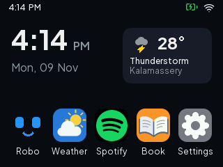
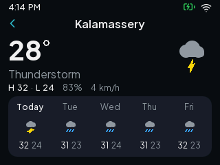
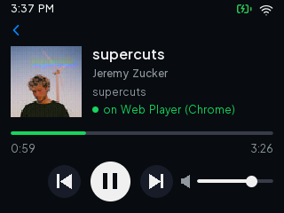
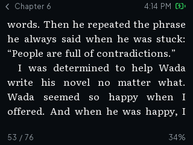
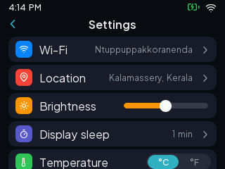
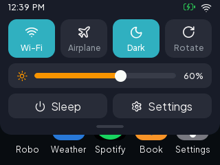

# Perch

A small phone-style OS for the LCDWiki **ES3C28P** board: ESP32-S3, 2.8" 320x240 display, capacitive touch, microSD.

| Home | Weather | Spotify | Book |
| --- | --- | --- | --- |
|  |  |  |  |
| **Reader** | **Settings** | **Control centre** | **Robo** |
|  |  |  |  |

## Apps

- **Robo**: an animated companion face. It reacts to touch, noise, the weather, the battery and Spotify, remembers how it has been treated, runs a focus timer and can act as a screensaver on USB power.
- **Weather**: current conditions and a 5-day forecast from Open-Meteo, for a saved place or your IP location.
- **Spotify**: a Spotify Connect remote. Now playing with album art, play/pause, skip and volume for whatever device is playing.
- **Book**: a text reader with a library of covers, chapters, bookmarks, three text sizes, three line spacings and saved progress. Justified text with best-fit line breaks, hyphenation, kerning, italics and bold, in Literata. Tap a page's top right corner to bookmark it (a ribbon marks the page). Hold a word to select it and tap another to stretch the selection, then **Highlight**; for a single word there is also **Define**. Every highlight is appended to `clippings.txt` on the card in the Kindle's "My Clippings" layout. The reading menu lists bookmarks and highlights under **Notes** and has **Go to**, which jumps to a percentage of the book. Books come from the microSD card.
- **Settings**: Wi-Fi, weather location, brightness, display sleep (backlight off after 1 to 30 idle minutes, any touch wakes it), light and deep sleep for battery use, °C/°F, light/dark theme, accent colour (six choices, used by every button, selection and marker), rotation in quarter turns (every screen has a portrait layout), battery, storage and About.

Gestures: swipe in from the left edge to go back, swipe sideways on Home to page through apps, and pull down from the top edge on any screen for the control centre: Wi-Fi, airplane mode, dark theme, rotation, brightness, Sleep and a shortcut to Settings. Push it back up, or tap below it, to close it.

## Getting started

You need [PlatformIO](https://platformio.org) and Python 3 with `pyserial` and `pillow`.

```bash
python3 -m venv ../.venv && source ../.venv/bin/activate
pip install platformio pyserial pillow
```

The firmware embeds one book from `data/book.txt`, which is not in the repo. Make one from any EPUB you own:

```bash
python book_convert.py "book.epub" data/book.txt
```

The converter also writes the cover thumbnail next to it as `data/book.cov`; the embedded book has no cover on the board, so copy both files into `/books` on the card if you want one.

Plug the board in over USB and flash:

```bash
pio run -t upload
```

On first boot, open **Settings > Wi-Fi** and join a network with the on-screen keyboard. The clock syncs over NTP and the timezone comes from the weather lookup.

## Power

Three idle timeouts in Settings, each tapped to cycle its value:

| Setting | Turns off | Wake | Roughly |
| --- | --- | --- | --- |
| Display sleep | backlight | any touch, instant | 70 mA |
| Light sleep | panel, Wi-Fi, CPU halted | any touch, Wi-Fi rejoins in a second or two | 5 to 10 mA |
| Deep sleep | everything but the wake circuit | any touch, reboots to Home | under 1 mA |

The touch that wakes the screen does nothing else. Light and deep sleep only start when no computer is attached over USB, so the board stays reachable for flashing; a wall charger does not count. Book progress is saved before deep sleep. The currents are estimates, not measurements.

Settings > Battery shows the charge level, cell voltage, the voltage trend and the change since power-on. The charger has no status line to the chip, so charging is inferred: a computer on USB, or the voltage step when a cable goes in or out. While charging, that step is subtracted before the level is worked out, and near the top the level is walked up over the top-off time, so the figure is an estimate.

## Spotify

1. Create an app at [developer.spotify.com](https://developer.spotify.com/dashboard) with the redirect URI `http://127.0.0.1:8888/callback`.
2. Put its Client ID in `spotify_auth.py`.
3. With the board plugged in, run `python spotify_auth.py` and approve in the browser.

The refresh token is stored on the board. Playback control needs Spotify Premium.

## Books

Open **http://perch.local** on a phone or computer on the same Wi-Fi. The first time, pair the browser: on the device open **Settings → Portal** and type the 6-digit code it shows (it changes every minute). No account is involved; the code gives that browser a token, kept for 30 days if you tick the box, and **Unpair all** on the same screen revokes them.

The portal lists the Perches it finds on the network, with battery, free space and book count, and one searchable library across the ones this browser is paired with. Drop EPUB files on the page or use **Add books**: they are converted in the browser, only the text is uploaded, and you choose which devices get a copy. A book's page shows its chapters, where each device's reader is, and lets you remove it from one device or all of them.

Books live in `/books` on the microSD card (FAT32), or on a small flash partition when no card is inserted. The book format is UTF-8 text: `\x02Title\nAuthor\n`, then chapters starting with `\x01Title\n`, one paragraph per line. `\x03` toggles italic and `\x04` bold (from `<em>` and `<strong>`), and a soft hyphen (U+00AD) marks a hyphenation point. The converters insert soft hyphens for English books from the hyph-utf8 en-US patterns in `portal/hyph-en-us.txt`, which the board also serves to the portal page. The reader breaks lines by minimum raggedness over each paragraph (as CrossPoint Reader does) and justifies them.

### Dictionary

**Define** reads any StarDict dictionary (`name.ifo`, `name.idx` and `name.dict`; unpack a `name.dict.dz` first) from a `dict` folder at the root of the SD card. A word not found as written is tried without its punctuation and in its base forms. To build an English one from WordNet (Princeton University, free to use and share):

```
curl -LO https://wordnetcode.princeton.edu/3.0/WordNet-3.0.tar.gz
python wordnet_dict.py WordNet-3.0.tar.gz dict
```

then copy the `dict` folder to the card. Without a card reader, `python put.py dict/*` sends the files over USB (about 220 KB/s). The first lookup after power-on reads the index once, which takes a moment for a large dictionary.

### Cloud sync (optional)

Reading positions can be shared between your devices, including the [e-paper Perch](https://github.com/JobinBiju/Perch-OS-E-Paper), through a small Cloudflare Worker on the free tier. It lives in its own repo, **[Perch-Cloud](https://github.com/JobinBiju/Perch-Cloud)**, which also documents the contract the firmwares follow and how to deploy your own.

A device saves its position when you leave the reader or it goes to sleep, and fetches the newest one when a book is opened; the most recently read position wins, and the reader shows "Synced from …" when it moves. Bookmarks and highlights are merged between devices too: each is sent when it is made or removed and whenever a book is opened. There are no accounts: every device holds the same long random **home key**.

To switch it on, open the portal, choose **Set up cloud sync**, enter your Worker's address, press **Generate** for a key and save; the page sends both to every paired device. Over USB the same is `sync <address> <key>` on the serial console. Only book file names, positions and device names leave your network.

Each book's cover goes along as a sidecar, `name.cov` next to `name.txt`: 4 header bytes (`PC`, width, height) and a 160x240 RGB565 image that the browser scales from the EPUB's cover. The board averages it down to its 32x48 list tile and the 48x72 tile of the portrait reading menu and rounds the corners; books without a cover get a coloured tile with the title's initials. Older, smaller sidecars still load. For e-paper Perches the portal also sends `name.cvl`, a 480x720 8-bit grey cover (`PL`, width and height as 16-bit little-endian) for their full-screen sleep image; this firmware accepts and deletes that file but does not use it.

Books converted with an older version keep working; drop the EPUB on the portal again to get its cover, hyphenation and accented characters. Reading progress is kept.

## Fonts

The UI uses Plus Jakarta Sans, the reader Literata (regular, italic, bold and bold italic), and icons come from Lucide. `python fontgen.py` renders the TTFs in `fonts/` into bitmap fonts in `src/fonts_data.h`, covering ASCII, Latin-1 and Latin Extended-A. Sizes and weights are the `SPECS` table in that script.

## Serial debug

The board listens on USB serial at 115200. `python drive.py 3 'k hello' shot:out.png` scripts a session and `python screenshot.py out.png` grabs the screen.

| Command | Action |
| --- | --- |
| `S` | screen dump |
| `b` | back |
| `1`-`5` | open an app |
| `p` | status: time, Wi-Fi, weather, sleep settings, last reset reason, Spotify worker |
| `z` | display sleep now |
| `P` | the last crash since power-on: reason and backtrace |
| `y [s]` | light sleep now; with seconds it also wakes on a timer |
| `Y [s]` | deep sleep now; with seconds it also wakes on a timer |
| `t x y` | tap |
| `d x0 y0 x1 y1 [ms]` | drag |
| `k text` | type into the open keyboard field |
| `f text` | render text in every font |
| `W` / `T` | fake weather / preview the other theme |
| `n a.b.c.d` | TCP-connect to a LAN host |
| `h host` | DNS, TCP 443 and TLS handshake test |
| `i` / `r` / `ls` | I2C scan / retry SD mount / list `/books` |

## Layout

| Path | What |
| --- | --- |
| `src/` | firmware: `main.cpp`, one header per app, `ui.h` drawing helpers, `net.h` Wi-Fi and weather, `spotify.h`, `portal.h` |
| `portal/` | the perch.local page and its in-browser EPUB converter |
| `fonts/`, `fontgen.py` | font sources and the bitmap font generator |
| `drive.py`, `screenshot.py` | serial tools |
| `spotify_auth.py`, `book_convert.py` | one-time Spotify link, EPUB to book text |

## Licence

Perch is released under the [GNU GPL v3](LICENSE). The bundled fonts keep their own licences: Plus Jakarta Sans and Literata under the SIL Open Font License, Lucide under ISC (see `fonts/`). The English hyphenation patterns are by Gerard D.C. Kuiken (see `portal/LICENSE-hyph-en-us.txt`).
