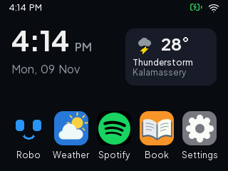
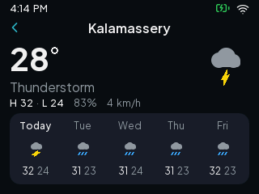
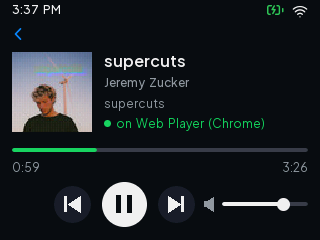
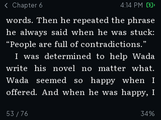
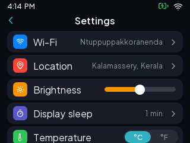
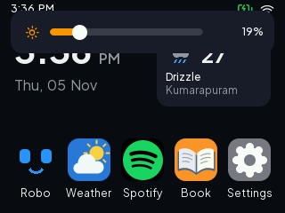

# Perch

A small phone-style OS for the LCDWiki **ES3C28P** board: ESP32-S3, 2.8" 320x240 display, capacitive touch, microSD.

| Home | Weather | Spotify | Book |
| --- | --- | --- | --- |
|  |  |  |  |
| **Reader** | **Settings** | **Brightness** | **Robo** |
|  |  |  |  |

## Apps

- **Robo**: an animated companion face that reacts to the microphone.
- **Weather**: current conditions and a 5-day forecast from Open-Meteo, for a saved place or your IP location.
- **Spotify**: a Spotify Connect remote. Now playing with album art, play/pause, skip and volume for whatever device is playing.
- **Book**: a text reader with a library of covers, chapters, three text sizes, three line spacings and saved progress. Justified text with best-fit line breaks, hyphenation, italics and bold, in Literata. Books come from the microSD card.
- **Settings**: Wi-Fi, weather location, brightness, display sleep (backlight off after 1 to 30 idle minutes, any touch wakes it), °C/°F, light/dark theme, accent colour (six choices, used by every button, selection and marker), 180° rotation, storage and About.

Gestures: swipe in from the left edge to go back, swipe sideways on Home to page through apps, and pull down from the top edge on any screen for the brightness slider.

## Getting started

You need [PlatformIO](https://platformio.org) and Python 3 with `pyserial` and `pillow`.

```bash
python3 -m venv ../.venv && source ../.venv/bin/activate
pip install platformio pyserial pillow
```

The firmware embeds one book from `data/book.txt`, which is not in the repo. Make one from any EPUB you own:

```bash
python book_convert.py "book.epub" data/book.txt
```

The converter also writes the cover thumbnail next to it as `data/book.cov`; the embedded book has no cover on the board, so copy both files into `/books` on the card if you want one.

Plug the board in over USB and flash:

```bash
pio run -t upload
```

On first boot, open **Settings > Wi-Fi** and join a network with the on-screen keyboard. The clock syncs over NTP and the timezone comes from the weather lookup.

## Spotify

1. Create an app at [developer.spotify.com](https://developer.spotify.com/dashboard) with the redirect URI `http://127.0.0.1:8888/callback`.
2. Put its Client ID in `spotify_auth.py`.
3. With the board plugged in, run `python spotify_auth.py` and approve in the browser.

The refresh token is stored on the board. Playback control needs Spotify Premium.

## Books

Open **http://perch.local** on a phone or computer on the same Wi-Fi and drop EPUB files on the page. They are converted in the browser and only the text is uploaded. The same page lists and deletes books.

Books live in `/books` on the microSD card (FAT32), or on a small flash partition when no card is inserted. The book format is UTF-8 text: `\x02Title\nAuthor\n`, then chapters starting with `\x01Title\n`, one paragraph per line. `\x03` toggles italic and `\x04` bold (from `<em>` and `<strong>`), and a soft hyphen (U+00AD) marks a hyphenation point. The converters insert soft hyphens for English books from the hyph-utf8 en-US patterns in `portal/hyph-en-us.txt`, which the board also serves to the portal page. The reader breaks lines by minimum raggedness over each paragraph (as CrossPoint Reader does) and justifies them.

Each book's cover goes along as a sidecar, `name.cov` next to `name.txt`: 4 header bytes (`PC`, width, height) and a 32x48 RGB565 thumbnail that the browser scales from the EPUB's cover image. The library and the reading menu show it; books without one get a coloured tile with the title's initials. The corners carry the key colour `0xF81F`, drawn transparent, so the tile is rounded in either theme.

Books converted with an older version keep working; drop the EPUB on the portal again to get its cover, hyphenation and accented characters. Reading progress is kept.

## Fonts

The UI uses Plus Jakarta Sans, the reader Literata (regular, italic, bold and bold italic), and icons come from Lucide. `python fontgen.py` renders the TTFs in `fonts/` into bitmap fonts in `src/fonts_data.h`, covering ASCII, Latin-1 and Latin Extended-A. Sizes and weights are the `SPECS` table in that script.

## Serial debug

The board listens on USB serial at 115200. `python drive.py 3 'k hello' shot:out.png` scripts a session and `python screenshot.py out.png` grabs the screen.

| Command | Action |
| --- | --- |
| `S` | screen dump |
| `b` | back |
| `1`-`5` | open an app |
| `p` | status: time, Wi-Fi, weather, display sleep, Spotify worker |
| `z` | display sleep now |
| `t x y` | tap |
| `d x0 y0 x1 y1 [ms]` | drag |
| `k text` | type into the open keyboard field |
| `f text` | render text in every font |
| `W` / `T` | fake weather / preview the other theme |
| `n a.b.c.d` | TCP-connect to a LAN host |
| `h host` | DNS, TCP 443 and TLS handshake test |
| `i` / `r` / `ls` | I2C scan / retry SD mount / list `/books` |

## Layout

| Path | What |
| --- | --- |
| `src/` | firmware: `main.cpp`, one header per app, `ui.h` drawing helpers, `net.h` Wi-Fi and weather, `spotify.h`, `portal.h` |
| `portal/` | the perch.local page and its in-browser EPUB converter |
| `fonts/`, `fontgen.py` | font sources and the bitmap font generator |
| `drive.py`, `screenshot.py` | serial tools |
| `spotify_auth.py`, `book_convert.py` | one-time Spotify link, EPUB to book text |

## Licence

Perch is released under the [GNU GPL v3](LICENSE). The bundled fonts keep their own licences: Plus Jakarta Sans and Literata under the SIL Open Font License, Lucide under ISC (see `fonts/`). The English hyphenation patterns are by Gerard D.C. Kuiken (see `portal/LICENSE-hyph-en-us.txt`).
